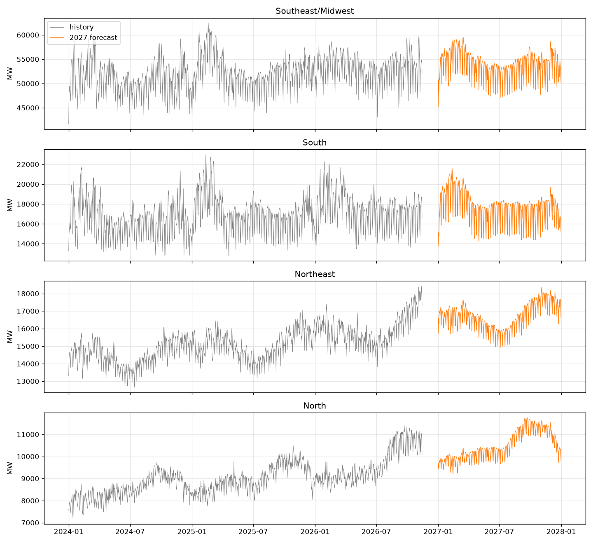

# ons_forecast

Forecasting daily peak electricity demand for Brazil's National Interconnected System (SIN), using open data from ONS.

> **Status:** part 1 done: SQL data layer, exploratory analysis, XGBoost vs. seasonal naive at 7 days, and a 2027 forecast. SARIMA and dbt come in part 2 (see Roadmap).

---

## The question

Brazil's grid operator (ONS) publishes daily maximum demand per subsystem. The practical question this repo answers:

**How far ahead can daily peak demand be predicted, and does a machine learning model actually beat a well-chosen naive baseline?**

The second half of that question matters more than the first. Most forecasting portfolios skip the baseline and report an impressive-looking error in isolation. Here the baseline is the benchmark every model has to clear.

---

## Why this dataset

Daily peak demand drives real decisions in the Brazilian power sector: generation dispatch, reserve margin, transmission constraints, and contract exposure for free-market energy traders. An error of a few percent on the peak is not an abstract metric — it is the difference between covering load and buying energy on the short-term market.

---

## Data

**Source:** [ONS Dados Abertos — Demanda Máxima Diária por Subsistema](https://dados.ons.org.br/dataset/demanda_maxima_di)

| Property | Value |
|---|---|
| Granularity | Daily, by subsystem |
| Subsystems | Southeast/Midwest, South, Northeast, North |
| Period used | 2024-01-01 – 2026-11-14 (1,049 days per subsystem, no gaps) |
| Formats used | CSV (`;`-delimited) and Parquet |
| License | Open data (ONS) |

Columns, as published (see `data/raw/DicionarioDados_DemandaMaximaDiaria.json`):

| Column | CSV type | Parquet type | Description |
|---|---|---|---|
| `id_subsistema` | text | VARCHAR | Subsystem code, space-padded (`"N  "`) |
| `nom_subsistema` | text | VARCHAR | Subsystem name, space-padded |
| `dat_referencia` | text | TIMESTAMP | Reference day |
| `din_demandaintegralizada` | text | TIMESTAMP | Timestamp of the maximum integrated demand |
| `val_demandaintegralizada` | text | DOUBLE | Integrated demand at the hour of the peak (MWh/h) |
| `din_demandainstantanea` | text | TIMESTAMP | Timestamp of the maximum instantaneous demand |
| `val_demandainstantanea` | text | DOUBLE | **Maximum instantaneous demand (MW) — the target** |

### Data volume — read this before judging the models

Three years of daily data gives roughly **1,050 observations per subsystem**. That is enough for seasonal structure (weekly and annual) but modest for anything data-hungry. This constraint shapes every modeling choice here, and the Limitations section says what it rules out.

---

## Two formats, one pipeline

The same pipeline runs against the two formats ONS publishes, side by side in one repo. This is deliberate: it isolates the format decision and makes the trade-off measurable instead of asserted.

| Notebook | Source format | Ingestion SQL |
|---|---|---|
| `notebooks/01_parquet.ipynb` | Parquet | `sql/00_raw_parquet.sql` |
| `notebooks/01_csv.ipynb` | CSV | `sql/00_raw_csv.sql` |

**What differs:** only the ingestion file. Staging, features, validation and models are shared (`sql/01–04`, `src/pipeline.py`). `python src/pipeline.py` asserts that both formats produce an **identical** feature table.

| | CSV | Parquet |
|---|---|---|
| Size on disk (3 files) | 358 KB | 138 KB |
| Ingestion time (DuckDB, cold) | ~1,400 ms | ~30 ms |
| Typed on read | no — everything is `VARCHAR`, cast in staging | yes — `TIMESTAMP`, `DOUBLE` |
| Still needs `TRIM` on codes | yes | yes |

Parquet wins on size, speed and typing. It does not fix the publisher's padded codes: format is not data quality.

---

## Repository structure

```
ons_forecast/
├── data/raw/                     # files as downloaded from ONS (small, committed)
├── sql/
│   ├── 00_raw_csv.sql            # the only format-specific step
│   ├── 00_raw_parquet.sql
│   ├── 01_stg_demanda_maxima.sql # typing, renaming, TRIM, dedup, period filter
│   ├── 02_dim_calendario.sql     # 2024–2027 calendar + holidays
│   ├── 03_fct_demanda_diaria.sql # one row per subsystem per day, gaps explicit
│   └── 04_fct_demanda_features.sql
├── src/pipeline.py               # builds the warehouse, baselines, CV, models
├── notebooks/
│   ├── 01_parquet.ipynb
│   └── 01_csv.ipynb
├── docs/figures/
├── outputs/forecast_2027.csv
├── requirements.txt
└── README.md
```

---

## Stack

| Layer | Tool | Why |
|---|---|---|
| Warehouse | DuckDB (in memory) | No server, no cost; anyone can clone and run |
| Transformation | Plain SQL files, run by DuckDB | Lags, rolling means and calendar features as window functions; ready to move into dbt |
| Holidays | `holidays` (national + optional: Carnival, Corpus Christi) | Registered as a table and joined in SQL |
| Modeling | pandas, XGBoost | |
| Visualization | matplotlib | |

The transformation layer is SQL rather than pandas on purpose. Lags, rolling means and calendar features are expressed as window functions, which is how this work is actually done in a warehouse.

---

## Data layer (SQL)

### `fct_demanda_features`

```sql
SELECT
    din_instante,
    id_subsistema,
    demanda_maxima_mw,

    LAG(demanda_maxima_mw, 7)   OVER w AS lag_7d,      -- also the seasonal naive forecast
    LAG(demanda_maxima_mw, 14)  OVER w AS lag_14d,
    LAG(demanda_maxima_mw, 364) OVER w AS lag_52w,

    AVG(demanda_maxima_mw) OVER (
        PARTITION BY id_subsistema
        ORDER BY din_instante
        ROWS BETWEEN 13 PRECEDING AND 7 PRECEDING
    ) AS media_movel_7d,

    dia_semana, mes, dia_ano, feriado
FROM fct_demanda_diaria JOIN dim_calendario USING (din_instante)
WINDOW w AS (PARTITION BY id_subsistema ORDER BY din_instante)
```

**Every window is strictly backward-looking and at least 7 days old.** At a 7-day horizon, only data up to t-7 is known on the forecast day, so `lag_1d` or a rolling mean ending at t-1 would be leakage. The constraint is enforced here in SQL rather than trusted to a later step.

`ROWS`-based lags only equal calendar lags if no day is missing. `fct_demanda_diaria` builds a date spine so gaps would surface as NULLs, not shift the windows.

### Data quality checks (in the notebooks)

Rows per subsystem, missing days, duplicates on (`din_instante`, `id_subsistema`), and min/mean/max per subsystem. Current data: 0 missing days, 0 duplicates.

---

## Method

| Tier | Model | Rationale |
|---|---|---|
| 0 | Seasonal naive — same weekday, previous week (`lag_7d`) | The honest floor. Demand is strongly weekly |
| 0 | Last-week mean (`media_movel_7d`) | Secondary reference. Previous-day persistence collapses to `lag_7d` at a 7-day horizon |
| 2 | XGBoost on the feature table | Handles calendar effects and multiple inputs jointly. One global model, subsystem as a feature |

**Forecast horizon:** 7 days ahead (main result), plus a 2027 long-horizon forecast (below).

### Validation

**Walk-forward (expanding window) cross-validation.** The training set grows forward in time; the test window always sits strictly after it. No shuffling, no random splits.

```
Fold 1: train [2024-01-01 → 2025-06-30]  test [2025-07-01 → 2025-09-30]
Fold 2: train [2024-01-01 → 2025-09-30]  test [2025-10-01 → 2025-12-31]
Fold 3: train [2024-01-01 → 2025-12-31]  test [2026-01-01 → 2026-03-31]
Fold 4: train [2024-01-01 → 2026-03-31]  test [2026-04-01 → 2026-06-30]
Fold 5: train [2024-01-01 → 2026-06-30]  test [2026-07-01 → 2026-08-14]
Holdout:                                 test [2026-08-15 → 2026-11-14]  (touched once)
```

### Metrics

| Metric | Why |
|---|---|
| **WAPE** | Primary. Robust where MAPE is distorted by scale differences between subsystems |
| MAPE | Secondary, for comparability with published literature |
| **Skill score vs. seasonal naive** | `1 − WAPE_model / WAPE_naive`. The number that actually matters |

---

## Results

### 7-day horizon, all subsystems

| Model | CV mean WAPE (5 folds) | Holdout WAPE | Holdout MAPE | Holdout skill vs. seasonal naive |
|---|---|---|---|---|
| Seasonal naive | 3.25% | 3.78% | 3.23% | baseline |
| Last-week mean | 4.28% | 4.78% | 4.73% | −26.6% |
| XGBoost | **3.00%** | **3.44%** | 3.53% | **+8.9%** |

XGBoost beats the seasonal naive in 4 of 5 CV folds and on the holdout. In fold 1 (Jul–Sep 2025) it ties. The gain is real but modest — a well-chosen naive is hard to beat without weather data.

### Southeast / Midwest subsystem, 7-day horizon, holdout

| Model | WAPE | MAPE | vs. seasonal naive |
|---|---|---|---|
| Seasonal naive | 4.58% | 4.59% | baseline |
| Last-week mean | 4.84% | 4.94% | −5.8% |
| XGBoost | **3.24%** | **3.19%** | **+29.2%** |

### 2027 forecast (long horizon)

Lags are unavailable a year ahead, so the 2027 model is different: a **linear trend per subsystem × an XGBoost seasonal ratio** on calendar features only (subsystem, weekday, month, day of year, holiday). XGBoost alone cannot extrapolate growth; the trend carries it.

Backtest of the method (train to 2025-11-14, forecast the next 365 days), against the annual naive (same weekday, 52 weeks earlier):

| | Annual naive WAPE | Model WAPE | Skill |
|---|---|---|---|
| All subsystems | 5.52% | **4.17%** | +24.4% |
| Southeast/Midwest | 4.67% | **3.82%** | +18.3% |

The daily 2027 forecast is in `outputs/forecast_2027.csv`; the chart is `docs/figures/07_forecast_2027.png`.



---

## Limitations

Stated up front, not buried.

- **No weather data.** Temperature is the dominant driver of peak demand, and it is absent here. This caps achievable accuracy, and any model in this repo would improve materially with a temperature series. Adding one is the highest-value next step.
- **Three years of daily data** (~1,050 points per subsystem) is thin. Annual seasonality is observed roughly three times, which is too few to estimate it confidently. This is why no deep learning model appears here — the data does not support one.
- **The 2027 trend is linear and fitted on under three years.** North and Northeast grew 5–8% a year in 2025–2026; the model extends that. A load-growth path from planning studies (e.g. EPE's PDE) would be a better anchor.
- **Point forecasts only.** The models return a single number, not a distribution. For dispatch or trading decisions, uncertainty bounds (P10/P50/P90) matter more than the central estimate. See Roadmap.
- **Daily peak, not the load curve.** Predicting the daily maximum is a different, easier problem than predicting the full hourly shape.
- **Revisions.** ONS notes that published values may be updated after release. This analysis uses data as retrieved on 2026-11-15 and does not model revision behaviour.
- **MMGD is itself estimated.** The distributed generation component is modelled by ONS from forecast weather, so part of the target carries upstream model error.

---

## Roadmap

- [ ] SARIMA as the Tier 1 classical benchmark
- [ ] Move `sql/` into dbt models with `schema.yml` tests (`not_null`, `unique`, `accepted_values`, range check)
- [ ] `src/ingest.py` to download raw files from ONS
- [ ] Add temperature data from INMET as an exogenous variable
- [ ] Probabilistic forecasting: quantile regression for P10 / P50 / P90
- [ ] Extend from daily peak to the full hourly load curve
- [ ] Per-subsystem model comparison (the South behaves differently from the Northeast)

---

## Running it

```bash
git clone https://github.com/dogeraldi05/ons_forecast.git
cd ons_forecast

python -m venv .venv && source .venv/bin/activate   # Windows: .venv\Scripts\activate
pip install -r requirements.txt

python src/pipeline.py          # self-check: CSV and Parquet produce identical features
jupyter notebook notebooks/     # open 01_parquet.ipynb or 01_csv.ipynb
```

---

## Author

**Douglas Geraldi** — Electrical Engineer (UNICAMP, B.Sc. and M.Sc.), 15 years in Brazil's power sector.

The domain framing in this repo — why daily peak matters, what drives it, which errors are expensive — comes from that background rather than from the dataset documentation.

[LinkedIn](https://linkedin.com/in/douglas-geraldi) · [GitHub](https://github.com/dogeraldi05)

---

## License

Code: MIT. Data: open data published by ONS, subject to its own terms.
